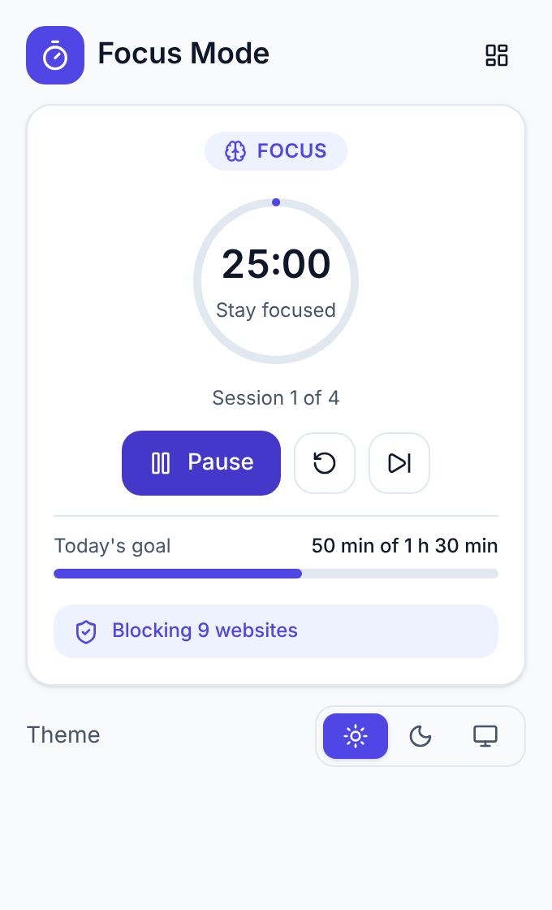
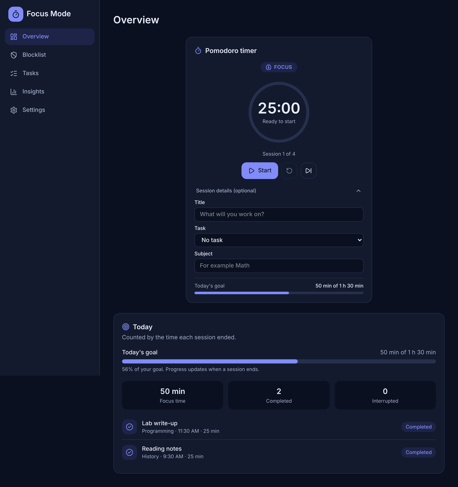

# Focus Mode

A local-first Chrome and Edge extension for students: a Pomodoro timer, a website blocker that only works while you focus, study tasks, session history and productivity insights.

Everything runs in your browser. There is no account, no server and no tracking. Your data is saved in `chrome.storage.local` on your own computer.

| Popup | Dashboard (dark) |
| --- | --- |
|  |  |

More screenshots (light and dark) are in [`docs/screenshots`](docs/screenshots).

## Features

- **Pomodoro timer** with start, pause, resume, reset and skip. Defaults: 25 min focus, 5 min short break, 15 min long break, long break after 4 focus sessions. All are configurable.
- **Website blocker.** Blocks the sites on your list only while a focus session is running. Breaks, paused and idle never block. Your list is kept either way.
- **Study sessions.** Each focus session can have a title, subject and task. Sessions are recorded as completed or interrupted.
- **Tasks and daily goal.** Create, edit, complete and delete tasks. See focus time per task and progress toward a daily goal.
- **Insights.** Last 7 or 30 days: totals, daily chart, subject breakdown, streaks and session history.
- **Notifications and sound** when a phase ends, both optional.
- **Export, import and reset.** JSON backup (importable), CSV for spreadsheets, and a reset that needs typed confirmation.
- **Light, dark and system themes** on every page.

## Quick start (Windows PowerShell)

You need [Node.js LTS](https://nodejs.org) (version 22.12 or newer; check with `node -v`) and Chrome or Edge, version 116 or newer.

```powershell
cd focus-mode
npm install
npm run build
```

Load the extension:

1. Open `chrome://extensions` (Chrome) or `edge://extensions` (Edge).
2. Turn on **Developer mode**.
3. Click **Load unpacked** and choose the **`dist`** folder inside `focus-mode`.
4. Pin the Focus Mode icon from the puzzle-piece menu.

After changing code, run `npm run build` again and press **Reload** on the extension card. `npm run dev` rebuilds automatically when you save a file (you still press Reload in the browser).

## Scripts

| Command | What it does |
| --- | --- |
| `npm run build` | Typechecks, then builds the extension into `dist/` |
| `npm run dev` | Rebuilds on every file change |
| `npm run typecheck` | TypeScript check only |
| `npm run lint` | ESLint |
| `npm test` | Runs all automated tests once (Vitest) |
| `npm run test:watch` | Re-runs tests as you edit |
| `npm run check` | Typecheck, lint and tests together (run this before a release) |
| `npm run icons` | Regenerates the PNG icons in `public/icons` |

## How it works

### Timer (FR-07, FR-08, BR-05)

The timer never counts seconds in the background. When a phase starts, the extension saves **the time it will end** (`endsAt`). The time left is always `endsAt − now`, calculated whenever someone looks. A `chrome.alarms` alarm wakes the background service worker at the end time, but the alarm is only a scheduler: if it fires late, or the browser was closed for hours, the worker reads the saved timestamps and works out what should have happened.

If a phase ended more than 2 minutes ago, the next phase is **not** started automatically, and no alert is shown, because it would be confusing to wake up to a timer that started long ago.

### Background service worker (`src/background/`)

The service worker is the only code that changes the timer, sessions and blocking rules. Pages (popup, dashboard) send it commands (`start`, `pause`, ...) and it replies with the new state. Commands go through one queue, so two quick clicks can never overwrite each other. The worker can be shut down by the browser at any time, so on every start it re-reads storage, re-arms the alarm and fixes the blocking rules.

### Website blocking (`src/services/blockingRules.ts`, `src/background/blockingManager.ts`)

Uses `declarativeNetRequest` dynamic rules. Each blocked domain becomes one redirect rule that sends **top-level page loads** to the extension's own `blocked.html` page. Subdomains are included (`reddit.com` also covers `old.reddit.com`); look-alike names such as `notreddit.com` are not. Rules are installed only during a running focus phase and are replaced in a single call only when they actually changed. Domains are validated and cleaned before a rule is made (`src/utils/domain.ts`).

Blocking only applies in the browser profile where Focus Mode is installed and enabled. It can be bypassed by disabling the extension, using another browser, or using another device. The extension says so in the app (FR-19, BR-07).

### Sessions (`src/services/timerLogic.ts`)

A session is saved when its focus phase **ends**:

- Finished its full length: **completed**.
- Stopped, reset or skipped before the end: **interrupted**, with the time that actually ran. Paused time is not counted.
- Stopped or skipped in under 1 minute: not recorded (probably a mis-click).
- A session counts toward the day it **ended**, in your local time zone.

Each session has a fixed id (`session-<start time>`), so saving the same session twice can never create a duplicate.

### Insights (`src/utils/analytics.ts`)

Every number on the Overview, Tasks and Insights pages is calculated from the stored session records. Nothing is sample data. A **streak day** is a day in which you reached your daily goal. Your streak does not break until a whole day has passed without reaching the goal. If you change the goal, past days are judged against the new goal.

### Storage (`src/services/storage.ts`)

All reads and writes of `chrome.storage.local` go through this file. Every value read from storage is checked and repaired by a sanitizer, so corrupted data falls back to defaults instead of crashing the extension. Storage has a `schemaVersion` (currently `1`) for future migrations.

| Key | Contents |
| --- | --- |
| `schemaVersion` | Storage format version |
| `settings` | Theme, durations, long-break interval, auto-start, daily goal, notification and sound switches |
| `timerState` | Status, phase, end time, remaining time when paused, completed count, current session details |
| `blocklist` | Blocked sites (id, domain, category, enabled) |
| `blockingStatus` | Whether blocking is working and how many rules are active |
| `tasks` | Study tasks |
| `sessions` | Recorded sessions |

### Project structure

The SRS suggests feature folders. This project groups by **layer**, with feature names in the file names, which keeps the small codebase flat and easy to navigate.

```
public/                 manifest.json and icons
popup.html, dashboard.html, blocked.html, offscreen.html   page entry points
src/
  background/           service worker: index, timerController, blockingManager, notifier, queue
  popup/  dashboard/  blocked/  offscreen/   the extension pages
  components/           shared UI (TimerPanel, FocusDetails, DataCard, charts, ui/ primitives)
  hooks/                React hooks that follow storage (useTimer, useTasks, useSessions, ...)
  services/             application logic and storage (timerLogic, blockingRules, backup, storage, ...)
  types/                data models (settings, timer, session, task, blocker)
  utils/                small pure helpers (domain, stats, analytics, time, chime)
  styles/               Tailwind theme tokens and global CSS
tests/                  test helpers (browser API mock, time zone setup)
docs/screenshots/       screenshots
```

Pure logic (timer rules, blocking rules, statistics, validation, import/export) lives in `services/` and `utils/` and never calls browser APIs, so it is tested directly.

## Permissions (NFR-10)

| Permission | Why it is needed |
| --- | --- |
| `storage` | Saves your settings, tasks, sessions and timer on your computer |
| `alarms` | Wakes the background worker when a phase ends |
| `declarativeNetRequest` | Redirects blocked sites to the blocked page during focus |
| `host_permissions` `http://*/*`, `https://*/*` | A redirect rule does nothing unless the extension has access to the site. This is required for blocking **any** site you add. Focus Mode never reads page content or browsing history |
| `notifications` | Phase-end notifications |
| `offscreen` | Plays the optional chime (a service worker cannot play sound) |

If Chrome's "Site access" for the extension is set to "On click", blocking will not work. Focus Mode detects this and shows a notice on the Blocklist page and in the popup.

## Privacy (NFR-11, NFR-13)

- All data stays in your browser. The extension makes **no network requests** and loads no remote code, fonts or scripts.
- It does not collect browsing history or page contents. The only thing it does with a website is compare its address to your blocklist (this happens inside the browser).
- Export files are plain text on your computer and contain your productivity data, so keep them private.

## Testing

```powershell
npm run check
```

**Automated (Vitest, 143 tests)** run in the `America/Los_Angeles` time zone on purpose, because it has daylight-saving changes:

| Area | What is covered |
| --- | --- |
| Timer logic | Start, pause, resume, reset, skip; long-break cycle; auto-start; late alarms; hours-long gaps; the 2-minute rule; corrupted state |
| Sessions | Completed and interrupted recording, paused time, the 1-minute rule, idempotent ids, details carried between sessions |
| Blocking | When rules are active, which domains, rule ids, change detection; domain validation including IPs, schemes and look-alikes |
| Background worker | The real worker code against a mocked browser: restarts, suspension, concurrent commands, rule failures and recovery, missing site access, notifications and sound |
| Data | Sanitizers for settings, tasks, sessions and blocklist; backup export/import with hostile files; CSV formula protection |
| Insights | Ranges across daylight saving, daily series, subject shares, streak edge cases |

**Also checked by hand during development** in a real Chromium browser with the unpacked build: full flows on every page, download and import of real files, real alarms creating notifications and the sound page, failed storage writes, an accessibility scan (axe-core, WCAG 2.2 AA) of every page and state in both themes with no violations, keyboard-only use, and load times with 3,000 stored sessions (popup ready in about 0.1 s, Insights in about 0.25 s). Those browser scripts are not part of this repository.

**Not tested by the author:** Microsoft Edge, and the visible look of notifications and the sound on a real desktop. Please run the checklist below in Chrome **and** Edge (SRS 10.3). Other Chromium browsers (Brave, Opera, Vivaldi) are not claimed as supported until tested (NFR-16).

## Manual test checklist (Chrome and Edge)

1. **Load** `dist` as an unpacked extension. The icon appears with no errors on the extension card.
2. **Timer:** start, close the popup, reopen it. The time keeps going. Pause and resume. Use the reset and skip buttons.
3. **Restart recovery:** start a timer, close the whole browser, wait a minute, reopen. The time left is correct. Repeat while paused.
4. **Blocking:** start a focus session and open a site from the blocklist. You see the blocked page. Pause: the site opens. Resume: blocked again. During a break: the site opens.
5. **Blocklist:** add `example.com`, try `not a domain` (you get a clear message), disable and remove a site.
6. **Tasks and sessions:** add a task, start a session for it with a 1-minute focus time (Settings), let it finish. It appears in Today and on the task.
7. **Interrupted:** start another session, stop it after 1+ minutes. It is listed as Interrupted.
8. **Insights:** check the numbers against your sessions. Change the daily goal in Settings and watch the streak and progress change.
9. **Notifications:** use Test notification and Test sound in Settings. Finish a phase and see the alert. If nothing shows, check your system's notification and Focus Assist settings.
10. **Export and import:** export the backup and the CSV files. Import the backup back. Try importing a non-backup file, which must be rejected without changing anything.
11. **Reset:** use Reset all data, typing `RESET`. Everything returns to defaults.
12. **Themes:** switch Light, Dark and System. Check the popup, dashboard and blocked page.
13. **Keyboard:** reach and operate the timer and settings with Tab, Enter and Space only.

## Requirement traceability

| Requirement | Where it is implemented | Tested by |
| --- | --- | --- |
| FR-01..FR-06 Timer controls, durations, cycle | `services/timerLogic.ts`, `components/TimerPanel.tsx`, `components/TimerSettingsCard.tsx` | `timerLogic.test.ts`, `worker.test.ts` |
| FR-07, FR-08, NFR-07, NFR-08, BR-05, 9.5 Persistence and reconciliation | `services/timerLogic.ts` (`reconcileTimer`), `background/timerController.ts`, `background/index.ts` | `timerLogic.test.ts`, `worker.test.ts` |
| FR-09, BR-02, BR-03 Paused or stopped sessions are not completed | `services/timerLogic.ts` | `timerLogic.test.ts` |
| FR-10, FR-11 Suggested list, add/enable/disable/remove | `types/blocker.ts`, `services/blocklist.ts`, `dashboard/pages/BlocklistPage.tsx` | `domain.test.ts` (validation), `backup.test.ts` (blocklist sanitizing), manual checklist |
| FR-12, 9.1 Domain validation | `utils/domain.ts` | `domain.test.ts` |
| FR-13, FR-14, BR-01 Blocking only during running focus | `services/blockingRules.ts` | `blockingRules.test.ts`, `worker.test.ts` |
| FR-15, FR-17, NFR-06 Redirect rules, unique ids, update only on change | `services/blockingRules.ts`, `background/blockingManager.ts` | `blockingRules.test.ts`, `worker.test.ts` |
| FR-16, BR-04 Blocklist kept when rules are removed | `background/blockingManager.ts` | `worker.test.ts` |
| FR-18 Blocking restored after restart | `background/index.ts`, `blockingManager.ts` | `worker.test.ts` |
| FR-19, BR-07 Blocking can be bypassed (communicated) | `pages/BlocklistPage.tsx`, `pages/SettingsPage.tsx`, `components/BlockingNotice.tsx` | Manual checklist |
| FR-20..FR-24 Sessions: details, recording, stop early, status | `services/timerLogic.ts`, `components/FocusDetails.tsx`, `components/TimerPanel.tsx`, `services/records.ts` | `timerLogic.test.ts`, `records.test.ts`, `worker.test.ts` |
| FR-25..FR-27 Tasks and task-session link | `services/tasks.ts`, `hooks/useTasks.ts`, `dashboard/pages/TasksPage.tsx` | `tasks.test.ts`, `records.test.ts` |
| FR-28, FR-29 Daily goal | `components/DailyGoalMeter.tsx`, `dashboard/pages/SettingsPage.tsx` | `stats.test.ts` |
| FR-30..FR-34, FR-36 Totals, counts, history, weekly charts, subjects | `utils/stats.ts`, `utils/analytics.ts`, `dashboard/pages/InsightsPage.tsx`, `components/charts/` | `stats.test.ts`, `analytics.test.ts` |
| FR-35 Streaks | `utils/analytics.ts` (`computeStreaks`) | `analytics.test.ts` |
| FR-37..FR-40 Notifications, sound, failure handling | `services/notifications.ts`, `background/notifier.ts`, `offscreen/`, `components/NotificationsCard.tsx` | `notifications.test.ts`, `worker.test.ts` |
| FR-41, FR-42 Themes | `hooks/useSettings.tsx`, `styles/index.css`, `components/ThemeSwitcher.tsx` | Manual checklist, accessibility scan |
| FR-43 Settings | `components/TimerSettingsCard.tsx`, `NotificationsCard.tsx`, `SettingsPage.tsx` | Manual checklist |
| FR-44 Export | `services/backup.ts`, `services/dataActions.ts`, `components/DataCard.tsx` | `backup.test.ts` |
| FR-45, 9.4, NFR-12 Import validation | `services/backup.ts` | `backup.test.ts` |
| FR-46 Reset with confirmation | `components/DataCard.tsx`, `services/storage.ts` (`resetAllData`) | Manual checklist |
| 9.2 Browser API failure | `background/blockingManager.ts`, `background/notifier.ts` | `worker.test.ts` |
| 9.3 Storage failure | `hooks/useTasks.ts`, `useBlocklist.ts`, `components/ui/NumberField.tsx`, `Toggle.tsx` | Manual (storage failure simulated during development) |
| NFR-01..NFR-03 Usability, empty states | Popup, dashboard pages | Manual checklist |
| NFR-04, NFR-05 Little background activity, fast pages | No background polling; pages update from storage events and a 250 ms display tick only while a timer is visible and running | Measured during development |
| NFR-09 Failures do not corrupt the timer | `background/timerController.ts` (saves state before alerts), sanitizers | `worker.test.ts` |
| NFR-10..NFR-13 Permissions and privacy | `public/manifest.json`, no network code | Build check (no remote code, no external URLs) |
| NFR-14 Manifest V3 | `public/manifest.json` | Loads in Chromium |
| NFR-15, NFR-16 Chrome and Edge | Unpacked build | Manual checklist (Edge not tested by the author) |
| NFR-17, NFR-18 Keyboard, focus, contrast | Shared components and theme tokens | axe-core scan, keyboard walk-through |
| NFR-19, NFR-20 Types and tests | TypeScript strict, ESLint, Vitest | `npm run check` |
| BR-06 No accounts, sync, social or AI | Nothing of the kind exists | n/a |

## Known limitations

- Blocking works only in this browser profile and can be bypassed (see above). It also cannot block a site that is already open in a tab; it blocks new navigations.
- Blocking is by domain only. Individual pages of a site cannot be blocked.
- Import replaces the sections it contains. It does not merge.
- In very rare cases, if a session finishes at the exact moment you import a backup, that one session can be lost.
- If your computer was asleep when a phase ended, you get no alert for it (by design), but the session is still recorded correctly.
- Data is not synced between devices. Use export and import to move it.

## Troubleshooting

- **"Cannot find module recharts" or other missing modules:** run `npm install` in the project folder. After that, in VS Code run **TypeScript: Restart TS Server**.
- **Blocking does nothing:** open the extension's details page and set **Site access** to **On all sites**. The Blocklist page also shows a notice when this is the problem.
- **No notifications:** check the operating system's notification settings (Windows Focus Assist / Do Not Disturb) for Chrome or Edge, and use **Test notification** in Settings.
- **No sound:** click **Test sound** in Settings and check the browser tab or system volume.
- **A change did not apply after you rebuilt:** press **Reload** on the extension card.

## Release notes for a store listing

- **Single purpose:** help students focus with a Pomodoro timer and a distraction blocker, and review their study progress.
- **Data use:** all data stays on the user's device. No data is collected, sold or transmitted.
- **Permission justifications:** use the table in the Permissions section above.
- **Before submitting:** run `npm run check`, run the manual checklist in Chrome and Edge, and zip the **contents** of the `dist` folder (the `manifest.json` must be at the top level of the zip).
